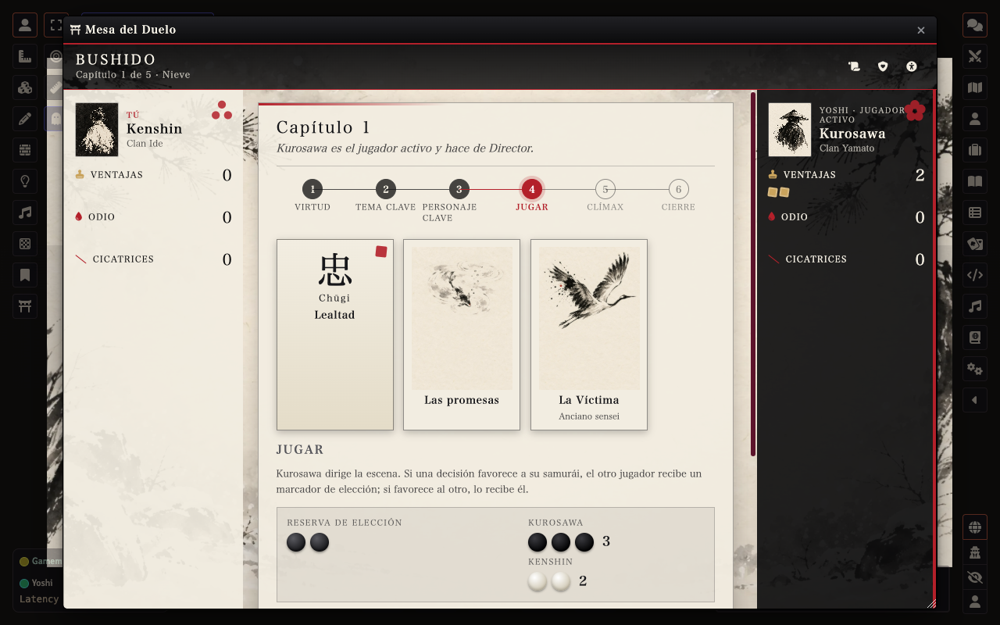
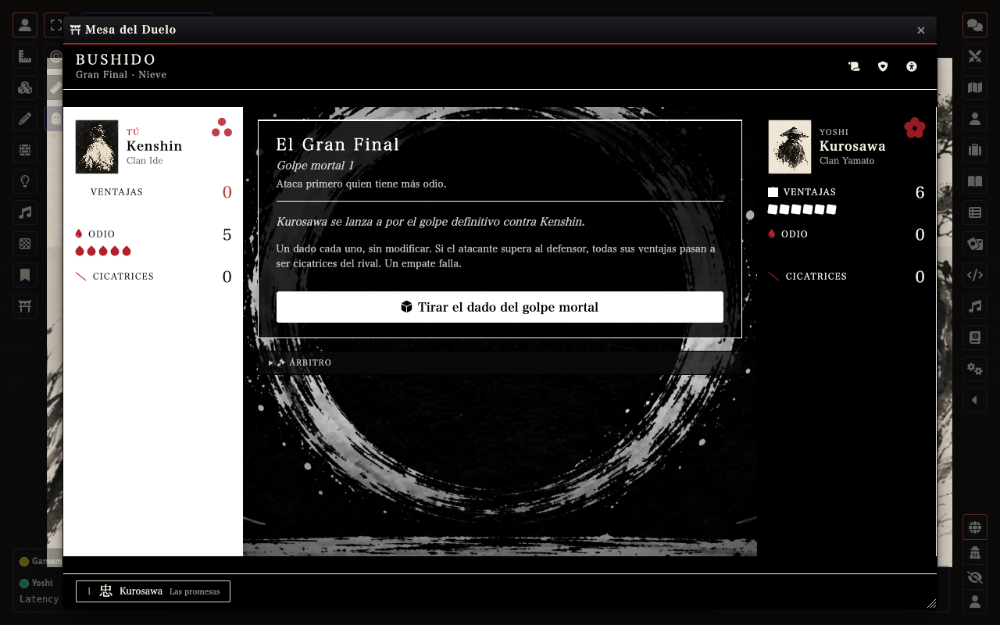
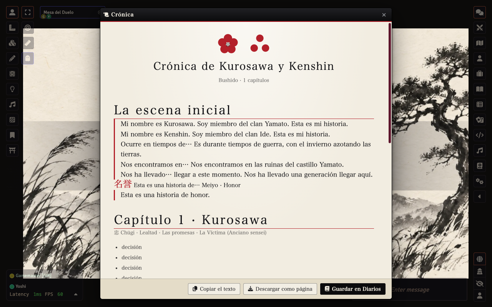

# MR · Un momento único

   

Sistema **no oficial** para Foundry VTT de ***Un momento único***, de Tobie Abad (The Hills Press, traducción de Víctor Romero): un juego de rol **para dos jugadores y sin Director** sobre dos samuráis que se miran a los ojos en un duelo final, y la historia de cómo llegaron hasta él.



## Qué hace

- **La Mesa del Duelo**: dos asientos simétricos (tinta contra papel) y, en el centro, el rollo con lo que toca en cada fase. Tú siempre estás a la izquierda.
- **La partida entera, guiada**: escena inicial con cuatro declaraciones alternadas → capítulos de seis pasos → lidiar con el odio → Gran Final → epílogo.
- **Las reglas, vigiladas pero nunca bloqueantes**: ventajas, odio y cicatrices se derivan de un registro único; los dados los tiran los jugadores (Dice So Nice si lo tienes); la apuesta a ciegas no se ve hasta que ambos la bloquean.
- **Gran Final en cine mudo**: al llegar el duelo, la interfaz pasa a blanco y negro duro con barras de cine.
- **Crónica**: al terminar, el sistema compone la historia jugada (virtudes, temas, decisiones, ganadores, odio, duelo y epílogo). Se copia, se descarga como página limpia o se guarda en Diarios.
- **Sin Director**: el estado vive en un diario que ambos asientos pueden escribir. Si hay Director, además tiene un cajón de **árbitro** (corregir contadores, saltar pasos, cambiar el clima).
- **Atmósfera**: siete climas (nieve, pétalos, verano, hojas, lluvia, niebla, polvo), sonido sintetizado (ambientes, efectos y un koto muy esporádico) con tres volúmenes por usuario.
- **Cuidado**: accesibilidad completa (texto, lectura, contraste, movimiento, botones grandes), Pausa/Velo/Tarjeta X anónimos, ventanas que recuerdan su posición, español e inglés.



## Instalación

En Foundry: **Sistemas → Instalar sistema** y pega el manifiesto:

```
https://github.com/ManuRomera/mr-un-momento-unico/releases/latest/download/system.json
```

Crea un mundo con el sistema, entra como Director una vez (se prepara la partida) y que cada jugador pulse **Mesa del Duelo** en los controles de escena (o `Alt+U`). Cada uno se sienta en un asiento, escribe nombre y clan, elige emblema, y a contar la historia.

Para jugar **solo dos personas**, basta con que los dos usuarios sean jugadores; el Director es opcional.

## Cómo se juega, en dos líneas

Contáis, en *flashbacks*, los capítulos que llevaron al duelo. Cada capítulo reparte siete marcadores de elección según a quién favorecen las decisiones; se cambian por dados, gana el total más alto y eso da ventajas (al ganador) u odio (al perdedor). Con eso se resuelve el Gran Final. Las reglas completas están en el libro: **cómpralo**.



## Criterios donde el libro no es claro

| Duda | Criterio |
|---|---|
| Empate en el golpe mortal | Falla el atacante |
| Los dos dados de consonancia | Cuentan para el tope de siete |
| Ventajas apostadas a ciegas | Se gastan, gane quien gane (ejemplo 9 del libro) |
| Empate de cicatrices **y** de odio | Tablas |

Todo está cubierto por pruebas automáticas (`npm test`), incluidos los ejemplos del libro.

## Ambientaciones

v1.0 trae **Bushido**. Una ambientación es un dato (virtudes, declaraciones de ejemplo, ideas de odio…) y otros paquetes pueden registrar la suya con `game.mrUnMomentoUnico.registerSetting({ id, name, virtues, themes, characters, … })` (forma en `module/data/bushido.mjs`). El libro propone más (Oeste, caballeros, pulp, ópera espacial, romcom) y se irán añadiendo como módulos.

## Para quien quiera tocar el código

```
npm test       # reglas, motor completo y estructura
npm run check  # sintaxis, JSON y rutas de arte
npm run build  # dist/mr-un-momento-unico.zip
```

El motor (`module/engine.mjs`) y las reglas (`module/rules.mjs`) son puros y no dependen de Foundry. El arte se importa con `scripts/import-art.py` (ver `docs/ARTE.md`). Las publicaciones salen al subir una etiqueta `vX.Y.Z`.

## Créditos y licencias

- Juego original: **Tobie Abad**, *Un momento único* (The Hills Press), texto bajo **CC BY 4.0**; traducción de Víctor Romero. Este sistema adapta sus reglas con atribución y cambios indicados en [NOTICE.md](NOTICE.md). No está afiliado a los autores.
- Código: MIT. Arte original de este proyecto; **no** se usan las ilustraciones del libro.
- Desarrollo: [Manu Romera](https://github.com/ManuRomera), con asistencia de Claude (Anthropic).

> Sistema no oficial. Si te ha gustado, apoya al autor comprando el juego.
